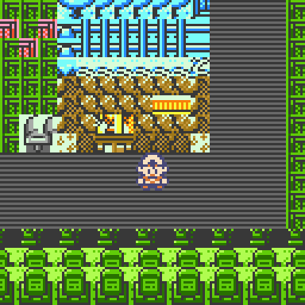
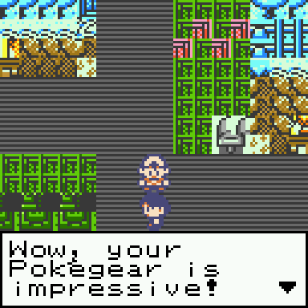
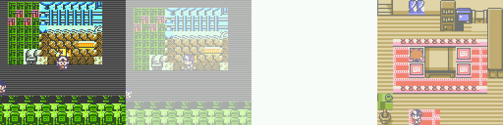
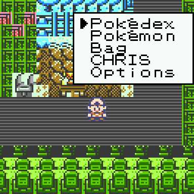
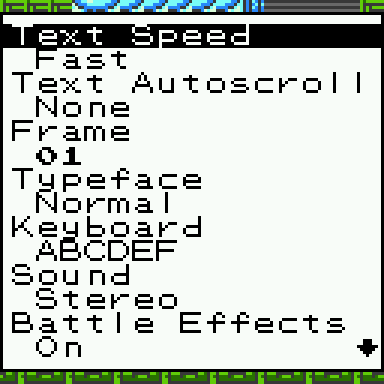

# Polished Crystal → Thumby Color (native Mote port)

A native port of [Polished Crystal](https://github.com/Rangi42/polishedcrystal) to the
TinyCircuits **Thumby Color**, built as a [Mote](https://github.com/austinio7116/mote)
game module. Not an emulator: the game's *content* (maps, tilesets, collision, sprite
art, palettes) is re-used as C tables extracted from the original repo, while the
*engine* is rewritten in C.



**Status: phase 1 under way — the game talks, and you can go indoors.** Eight real maps
load at runtime — New Bark Town, Route 29, Cherrygrove City and the five interiors of New
Bark Town (Elm's lab, your house, your neighbours', Lyra's and Elm's) — drawn from the
original block, metatile, palette and sprite data. The player walks in 16 px grid steps with the map's
own collision, NPCs face the way their `object_event` says (spinners rotate, and they
block their cell), sprites are drawn in Y order, and **pressing A in front of an NPC
opens that NPC's real dialogue** — the game's own text bytecode, printed with the game's
own 8×8 font, re-wrapped to 15 columns, paged and revealed a letter at a time.



**MENU opens the pause menu**: a window of the game's own entries (`#dex`, `#mon`, `Bag`,
`<PLAYER>`, `Options` — so it prints *Pokédex*, *Pokémon* and your name), with a wrapping
cursor and a scrolling window. The first four screens do not exist yet, so A just closes
the menu; **Options opens the game's own settings screen**: all thirteen of them
(*Text Autoscroll*, *Battle Style*, *#dex Units*, …) with their real values, LEFT/RIGHT to
change one and the state kept in memory. Text speed is wired to the dialogue, so *Instant*
really does print a page at once. Turning **Running Shoes** on (or leaving it off and
holding B) works too: the player crosses a cell in 8 frames instead of 16, with the walk
cycle at twice its usual speed. So does *Turning Speed*: asking for a direction you are not
facing turns in place first — 8 frames at Slow, 4 at Fast — and a tap turns without taking
a step. And walking into a wall, an NPC or the map edge has the original's push: the walk
cycle keeps going on the spot while you stay on your cell, facing the obstacle.

**Doors work.** Walk into a doorway and the screen fades to white in 10 frames, the
interior is loaded while it is white and it fades back in over 10 more — the original's
`MAPSETUP_DOOR`, which is the whole door animation: Polished Crystal has no animated door
tile. Inside, the tile colours switch to the game's `indoor` palette group. To leave,
stand on the doormat and push down: warp carpets fire when the step in the direction you
are holding cannot start, exactly like `CheckWarp`. Floors that were never extracted
(the 2F of the two houses, the stairs in your house) are closed doors for now.







Scripts, map connections (walking between maps), battle and audio are not ported yet —
see [`TASKS.md`](TASKS.md) for the full inventory and the phased plan.

## Quick start

```sh
scripts/setup.sh                  # cmake + SDL2 (headless) + Mote's host emulator + ARM gcc
python3 tools/extract.py          # game data -> game/src/gen/world.h
scripts/build.sh                  # build the module (.so)
scripts/build.sh --device         # + the deployable .mote
scripts/export.sh                 # package dist/PolishedCrystal-<version>.mote + manifest
scripts/test.sh                   # unit tests + scenarios
./scripts/shot.sh artifacts/overworld.png 45 "a:2-5,down:20-70"
MOTE_DT_MS=16 ./scripts/shot.sh artifacts/talk.png 214 "a:2-5,left:20-99,down:110-112,a:125-128"
./scripts/shot.sh artifacts/menu.png 70 "a:2-5,menu:20-23,down:40-43"
./scripts/perf.sh 900             # fps / raster_us from mote->perf()
./scripts/run.sh                  # emulator window (needs a display)
```

`setup.sh` installs everything under `toolsrc/` because this VM has no root and no
system SDL2; it is idempotent, so re-run it after the sandbox is restored.

## Layout

```
game/src/game.c      Mote glue (vtable, arena, input) — the only file that talks to Mote
game/src/ow/         overworld: map, camera, player, render (a system complex enough for a folder)
game/src/text/        dialogue: the game's font, its text bytecode, the textbox
game/src/ui/          menu windows: the cursor/scroll list and the START menu
game/src/gfx_sprite.c  sprite expansion and blitting (simple enough to stay one file)
game/src/gen/        generated data tables (do not edit)
tools/           extract.py (Polished Crystal -> C), preview_map.py, moteinfo.py
dist/            packaged .mote + manifest (gitignored: it embeds original content)
tests/           unit tests per module + readable behaviour scenarios
scripts/         setup, build, test, shot, run, perf, export
docs/            findings, data formats, architecture, workflow, conventions
TASKS.md         every system left to port, and the plan
vendor/          third-party checkouts (gitignored)
```

## Documentation

| Doc | Contents |
|---|---|
| [docs/README.md](docs/README.md) | index and the one idea behind the port |
| [docs/01-target-hardware.md](docs/01-target-hardware.md) | Thumby Color + Mote: real limits, ABI, memory model |
| [docs/02-pc-anatomy.md](docs/02-pc-anatomy.md) | measured size of every subsystem in Polished Crystal |
| [docs/03-content-formats.md](docs/03-content-formats.md) | the data formats, and the traps in them |
| [docs/04-port-architecture.md](docs/04-port-architecture.md) | how the port is built, what is reused, what is rewritten |
| [docs/05-dev-workflow.md](docs/05-dev-workflow.md) | build loop, headless screenshots, scripted input |
| [docs/06-findings-log.md](docs/06-findings-log.md) | findings and dead ends, so they are not repeated |
| [docs/07-conventions.md](docs/07-conventions.md) | **organisation and test rules** (file vs folder, every module tested, scenario format) |
| [AGENTS.md](AGENTS.md) | operating instructions for an AI agent working in this repo |

## Contributing shape

Code is organised by complexity: a simple piece is a single file, a complex one gets its
own folder. Every module has a unit test in `tests/unit/`, and behaviour is described by
plain-text scenarios in `tests/scenarios/` (initial state → steps → final state). Build
with `scripts/build.sh`, not `mote build` directly. Details:
[docs/07-conventions.md](docs/07-conventions.md).

## Legal

Polished Crystal is a fan hack; Pokémon is Nintendo/Game Freak IP. Keep this a personal
project — don't publish builds bundling the original content.
